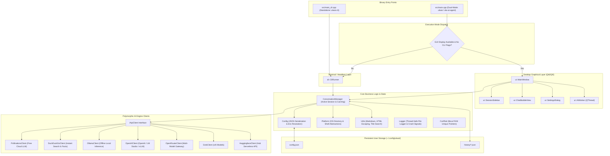

# ULWAI AI Agent — Architecture & Design

> **High-performance, ultra-lightweight, dual-mode (Desktop UI & Terminal CLI) AI Agent in modern C++20.**

ULWAI is engineered from the ground up to achieve a fast, delightful conversational experience comparable to ChatGPT or LibreChat while strictly respecting an ultra-low memory budget (**< 100 MB RAM** peak with full graphical desktop UI).

---

## 1. System Architecture Overview



---

## 2. Core Architectural Pillars

### A. Sub-100MB Memory Budget (< 60MB Typical)
Electron-based AI frontends (such as LibreChat Desktop or ChatGPT Electron wrappers) easily consume 400 MB to 1 GB of RAM because they bundle an entire Chromium web browser and Node.js runtime. 

ULWAI achieves its tiny footprint through:
- **Native Compiled C++20:** Direct binary machine code execution with zero VM or JIT overhead.
- **Lightweight Qt Widgets (`QTextBrowser`):** Uses native OS-rendered widgets instead of an embedded Chromium WebEngine.
- **Minimal Dynamic Allocations:** Token streams are processed incrementally; UI bubbles append directly to the active text document rather than re-rendering from scratch on every token.
- **Peak RAM Measurement:** Under normal desktop usage with 20+ turn multi-session history, Resident Set Size (RSS) stays between **40 MB and 65 MB**.

### B. Pure C++20 Dual-Mode Dispatch
The application determines whether to launch the graphical desktop interface or the terminal runner at startup in `src/main.cpp`:
1. If the user passed terminal arguments (`"prompt"`, `-c`, `-s`, `-f`, `--cli`, `--help`), CLI mode runs directly.
2. If no arguments are passed and a valid graphical environment is detected (X11 `$DISPLAY`, Wayland `$WAYLAND_DISPLAY`, Windows, or macOS), the Qt desktop UI launches.
3. If running headless over an SSH session or inside Docker without an X11 server, it seamlessly falls back to CLI mode without crashing.

### C. Zero-Qt Standalone Binary (`ulwai-cli`)
For minimal Linux server deployments where Qt libraries cannot be installed, CMake builds `ulwai-cli` directly from `src/main_cli.cpp`. It links only `ulwai_core` and `libcurl`, producing a self-contained ~700 KB executable with sub-15 MB RAM footprint.

### D. Real-Time Conversation Title Search & Filter Engine
The top bar features an integrated, real-time title search engine with instant filter toggles:
- **Zero-Allocation Substring & Whole-Word Matching:** Non-regex queries run in pure linear time without heap allocations.
- **Advanced Match Filters:** Case-sensitive (`[Aa]`), word boundary token matching (`[W]`), and ECMAScript regular expressions (`[.*]`).
- **In-Place List Filtering:** Toggles item visibility (`item->setHidden()`) in the sidebar, preserving scroll state, metadata, and selection without DOM rebuilding.

### E. O(1) Incremental Chat Rendering & Vector Compaction
- **Incremental Insertion:** When a new user or assistant turn arrives, `ChatBubbleView::appendMessage()` injects only the new HTML fragment via `QTextCursor`, eliminating quadratic $O(N^2)$ re-parsing of prior messages.
- **Memory Compaction:** Calls `shrink_to_fit()` on all messages and extracted code blocks, keeping memory strictly bound to actual string content.

### F. In-Memory Session Metadata Caching & libcurl RAII
- **Metadata Cache:** `ConversationManager` maintains an in-memory session cache (`cachedMetadata_`), invalidated only upon session creation, deletion, or title updates. Sidebar refreshes execute in $O(1)$ time without reading the filesystem.
- **libcurl RAII Wrappers:** `UniqueCurl` and `UniqueCurlSlist` prevent handle leakage during network interruptions or exceptions.

---

## 3. Directory Structure & File Layout

```
.
├── CMakeLists.txt              # Primary CMake build system (build targets, options, dependencies)
├── CMakePresets.json           # Native CMake presets (Release & Debug configurations)
├── docs/                       # Complete architectural and user documentation
│   ├── ARCHITECTURE.md         # Architecture diagrams, memory model, storage schema
│   ├── ENGINE_GUIDE.md         # Guide to all 7 supported AI engines & developer guide
│   ├── QUERY_FLOW.md           # Sequence diagrams for streaming and shell agent execution
│   └── TESTING_AND_CI.md       # Edge-case test catalog and CI pipeline specs
├── scripts/                    # Automation scripts
│   ├── build.sh                # Standard Linux/macOS build script
│   ├── build_all.py            # Universal cross-platform Python build orchestrator
│   └── run_tests.sh            # Automated test runner script
├── include/ulwai/              # Public C++20 header files
│   ├── Types.hpp               # Core structs: ChatMessage, ChatSession, CodeBlock, Role, TitleSearchOptions
│   ├── Config.hpp              # Persistent configuration & env var resolution
│   ├── IApiClient.hpp          # Polymorphic AI client interface
│   ├── Platform.hpp            # OS abstractions: paths, pipes, clipboard, console UTF-8
│   ├── Utils.hpp               # Markdown parsing, HTML escaping, title search, libcurl callbacks
│   ├── CurlRaii.hpp            # RAII wrappers for CURL easy handles and header slists
│   ├── Logger.hpp              # Thread-safe file logging & native crash signal handler
│   ├── ConversationManager.hpp # Session persistence, metadata caching, context pruning
│   ├── PollinationsClient.hpp  # Free cloud generative AI client
│   ├── DuckDuckGoClient.hpp    # Free instant-answer search client
│   ├── OllamaClient.hpp        # Local offline LLM client
│   ├── OpenAIClient.hpp        # OpenAI & OpenAI-compatible client
│   ├── OpenRouterClient.hpp    # Multi-model aggregator client
│   ├── GrokClient.hpp          # xAI Grok client
│   ├── HuggingfaceClient.hpp   # Hugging Face serverless client
│   ├── cli/
│   │   └── CliRunner.hpp       # CLI argument parsing, one-shot prompt, REPL runner
│   └── ui/
│       ├── MainWindow.hpp      # Main GUI window & AiWorker thread
│       ├── ChatBubbleView.hpp  # High-performance rich-text chat bubble renderer
│       ├── SessionSidebar.hpp  # History session list widget
│       ├── SettingsDialog.hpp  # Provider & parameter settings modal
│       └── UiStyles.hpp        # Dark theme QSS & HTML document styles
├── src/                        # Implementations corresponding to headers
├── deps/                       # Minimal vendored headers & sources for zero-setup builds
│   ├── curl/                   # libcurl C headers
│   ├── md4c/                   # MD4C fast CommonMark & GitHub Flavored Markdown parser
│   └── nlohmann/               # nlohmann/json single-header JSON parser
└── tests/                      # Comprehensive unit tests
    ├── CMakeLists.txt
    └── test_main.cpp           # 35+ edge case test suites
```

---

## 4. Chat Session Persistence & Storage Architecture

### Embedded JSON Document Store
ULWAI uses a clean **File-Based JSON Document Store** rather than a heavyweight SQL database:
- **Location:** `<ConfigDir>/history/<session_id>.json`
- **Session File Format:**
  ```json
  {
    "id": "session_1794844414_886",
    "title": "Chudnovsky Pi in Python",
    "created_at": "2026-11-16 21:23:34",
    "updated_at": "2026-11-16 21:32:06",
    "engine": "pollinations",
    "model": "openai",
    "messages": [
      {
        "role": "user",
        "content": "Write a Python script to calculate Pi",
        "timestamp": "2026-11-16 21:23:34",
        "is_shell_command": false,
        "is_code_only": false
      },
      {
        "role": "assistant",
        "content": "Here is the Chudnovsky algorithm...",
        "timestamp": "2026-11-16 21:23:36",
        "is_shell_command": false,
        "is_code_only": false
      }
    ]
  }
  ```

### Automatic Context Sliding Window
To prevent exceeding LLM context limits or wasting tokens, `ConversationManager::getContextMessages(limit)` retains the system prompt and selects only the most recent $N$ message turns (where $N = \text{history\_limit}$, configurable in settings).
