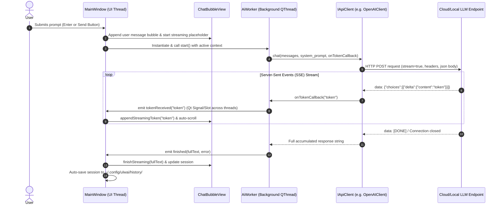
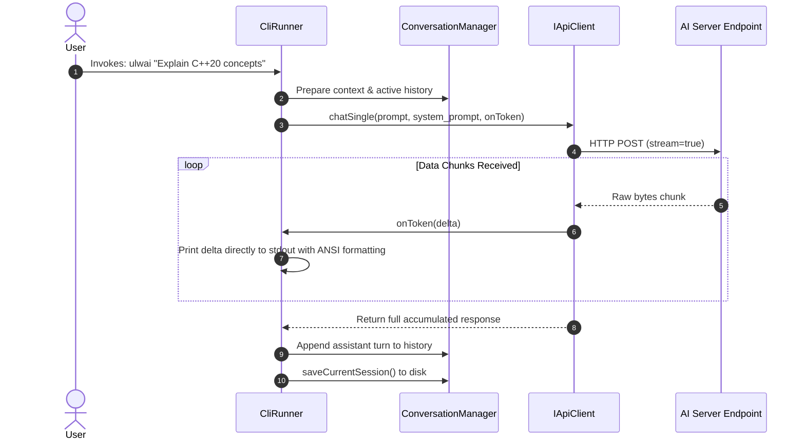
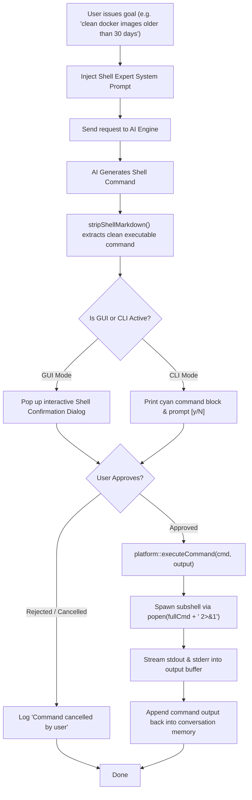

# ULWAI AI Agent — Query Flow & Streaming Architecture

> **Complete architectural execution flows for UI background threads, CLI token streaming, and safe shell execution.**

---

## 1. Desktop UI Asynchronous Query & Token Streaming

In Desktop UI mode, responsiveness is maintained by offloading network I/O and SSE parsing to a dedicated background worker thread (`AiWorker`, subclassing `QThread`). This prevents the Qt GUI event loop from freezing, ensuring silky 60 FPS UI performance even during long generational queries.

### Key Implementation Details:
1. **Thread Boundary Safety:** `AiWorker` never touches Qt UI widgets directly. All communication is conducted via Qt's queued signals and slots mechanism (`tokenReceived`, `finished`), which automatically marshals data onto the main UI thread.
2. **Cancellation Support:** When the user clicks `Stop`, `AiWorker::cancel()` sets an atomic flag (`cancelled_`), which terminates the libcurl transfer loop cleanly.

---

## 2. Terminal CLI Streaming & Typewriter Flow

In CLI mode, ULWAI operates with zero Qt dependencies. The streaming flow directly binds libcurl data transfer chunks to `stdout`:

---

## 3. Shell Command Agent Mode (`-s`) Safety Flow

When operating in **Shell Mode** (`-s` or `--shell`), ULWAI guarantees that **no command runs without explicit interactive user approval**.

### Safety Guarantees:
- **Explicit User Gate:** No automated subshell execution can bypass the confirmation prompt.
- **Output Re-ingestion:** The command's stdout and stderr are fed back into the multi-turn context, allowing the user to ask follow-up questions such as *"Why did that command fail?"* or *"Analyze this output"*.
